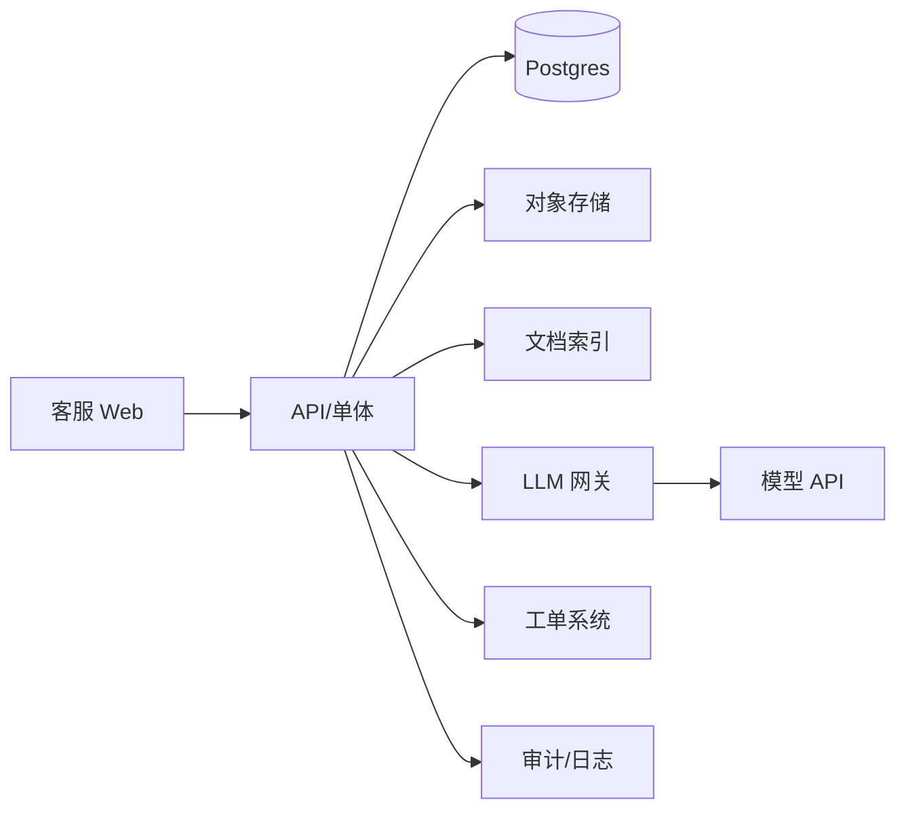

# 示例：企业 AI 客服工作台（M2 + M3）

> 用一个中等复杂度项目演示如何把本 kit 走完。不是照抄模板；重点是看每个阶段“为什么这样取舍”。

## 0. 项目简报（摘要）

- **用户**：50 人内部客服团队。
- **任务**：客户问题进来后，客服需要查政策/订单、草拟回复、人工确认后发送。
- **结果**：首次响应时间从 10 分钟降到 3 分钟；错误回复率不高于人工基线。
- **非目标**：不做自动退款、不做全渠道接入、不做多语言。
- **约束**：已有 Postgres 与工单系统；数据含订单与个人信息；模型 API 可用但成本需控制。
- **质量属性优先级**：准确性 > 可控性 > 延迟 > 成本。
- **AI 判断**：需要“检索 + 草拟 + 工具查询”，但发送必须人工审批 → 工具型 Agent，自主级别“建议 + 审批”。

## 1. 架构判断

### 规模信封

- 50 客服，峰值 20 QPS 查询；工单 10 万/年；单次回复 p95 < 8s；单次成本 < ¥0.2。
- 不需要微服务；一个模块化单体 + 一个 worker。

### 数据与状态

- **事实源**：Postgres（工单、用户、订单、审批记录）。
- **检索索引**：文档切块 + 向量索引；可重建，不作为事实源。
- **对象存储**：附件。
- **模型调用**：只记录必要输入、输出摘要、trace id，不把敏感原文长期保存。

### C4 L2（简图）

### 关键决策（ADR 摘要）

1. **模块化单体而非微服务**：50 人团队、单库、低峰值；拆分只会增加部署和排障成本。
2. **RAG 做知识检索，不微调模型**：政策和订单经常变；需要引用和权限过滤；微调无法解决实时性。
3. **发送必须人工审批**：错误回复会造成客诉/合规风险；Agent 只草拟，不自动外发。
4. **工具只读 + 人工确认**：先接 `search_docs`、`get_order`；退款等写操作不在本期。

### 失败模式

- 检索无结果 → 明确“无依据”，转人工；
- 订单系统超时 → 显示“查询失败”，可重试，不编造；
- 模型输出引用不匹配 → 校验引用，失败则拒绝草稿；
- 提示注入 → 文档内容当数据；工具白名单；不执行文档内指令；
- 成本超限 → 降级到只检索不生成，并告警。

## 2. Agent 规格（摘要）

- **工作**：基于工单与知识库，给出带引用的回复草稿，并查询订单状态。
- **循环**：ReAct，最多 6 步；无依据/超时/低置信度停止。
- **工具**：
  - `search_docs(query, filters)`：只读，返回片段 + 文档 id + 权限标记；
  - `get_order(order_id)`：只读，返回状态/物流；需租户校验；
  - `draft_reply(ticket_id, evidence, tone)`：只生成草稿，不发送。
- **上下文**：系统约束 + 工单摘要 + 检索片段（≤5 条）+ 工具结果；历史只保留最近 3 轮摘要。
- **人工检查点**：发送前必须客服确认；引用缺失时禁止发送。
- **预算**：≤6 步、≤8k tokens、≤¥0.2、p95≤8s。
- **评测**：100 条真实历史工单；指标为“草稿可直接发送率、引用正确率、无依据率、工具成功率、p95、成本”。

## 3. 评测计划（摘要）

| 分组 | 规模 | 检查 |
|---|---|---|
| 正常问答 | 50 | 草稿可发送、引用正确 |
| 无答案 | 15 | 明确拒答/转人工，不编造 |
| 订单查询 | 15 | 工具调用正确、权限正确 |
| 超时/失败 | 10 | 可见错误、可重试、不产生错误承诺 |
| 提示注入 | 5 | 不执行文档内指令 |
| 越权/跨租户 | 5 | 不泄露其他租户数据 |

门禁：引用正确率 ≥ 95%；无依据率 ≤ 2%；高危安全 0；p95 ≤ 8s；单次成本 ≤ ¥0.2。

## 4. 首个纵向切片

1. 客服打开工单；
2. 点击“生成草稿”；
3. 后端检索文档 + 查订单；
4. 返回带引用的草稿与“发送/编辑/拒绝”；
5. 客服确认后调用现有发送接口；
6. 记录 trace、引用、耗时、成本、反馈。

先 mock 模型，只跑通链路；再接真实模型；再接权限与评测。

## 5. 上线清单（节选）

- [x] 租户/角色隔离测试
- [x] 文档权限过滤先于检索
- [x] 发送前人工确认
- [x] 引用校验与无依据拒答
- [x] 工具白名单、只读
- [x] 超时/重试/降级
- [x] 日志脱敏、成本告警
- [x] 评测门禁 + 失败样例回归
- [x] 回滚：关闭生成、保留人工回复
- [x] 用户反馈入口

## 6. 演进触发

- 草稿可直接发送率长期 > 70% 且错误率低于人工 → 考虑半自动发送（仍需抽检）；
- 文档量/租户增长导致检索变慢 → 评估分片/混合检索；
- 工具调用扩展到退款等写操作 → 引入审批、幂等、额度与沙箱；
- 单次成本上涨 > 50% → 模型路由/缓存/更短上下文；
- 多团队接入 → 再评估拆服务与权限模型。

## 这个例子体现的原则

- 先架构后 Agent；
- Agent 只做“建议”，不越权；
- RAG 不是向量库，要有权限、引用、无答案和评测；
- 先纵向切片，再加固；
- 每个决策都有代价和触发信号。
