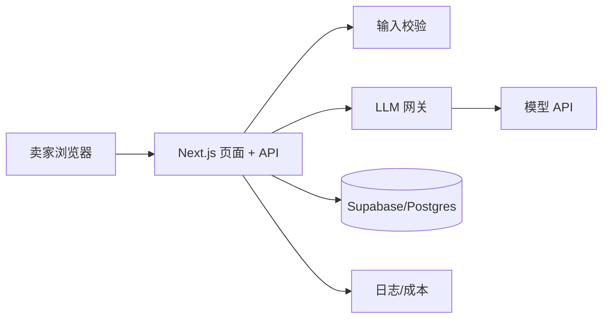

# 示例：AI 商品文案生成器（M1）

> 一个“几天 MVP”示例。重点看：什么时候**不需要 Agent**，以及 M1 的最低产物是什么。

## 0. 模式

- 模式：**M1 · MVP**
- 用户：独立站/跨境小卖家（1–2 人）
- 任务：输入商品卖点与目标人群，生成 3 条可用的商品文案
- 结果：从“憋 30 分钟”缩短到“5 分钟内选一条并修改”
- 非目标：不做批量上架、不做图片生成、不做多语言、不做支付

## 1. 项目简报（压缩版）

| 项 | 内容 |
|---|---|
| 用户 | 不会写英文文案的小卖家 |
| 场景 | 新品上架前需要标题/卖点/详情页开头 |
| 现有替代 | 自己写、抄竞品、找兼职 |
| 成功指标 | 10 个用户中 ≥6 个能直接使用/稍改即用 |
| 约束 | 1 周内上线；预算 $50 模型费；单次 < 10s |
| 非目标 | 账号体系、支付、批量、团队协作 |
| 质量属性 | 可用性 > 速度 > 成本 |
| AI 形态 | **单次 LLM 调用**，不需要 Agent |

## 2. 架构

**模块化单体**，不为 MVP 拆服务。



- 前端：Next.js 单页 + 一个结果页。
- API：`POST /api/generate`，输入校验、超时、限流。
- 数据：保存生成记录（可选），用于反馈与后续评测；不存敏感信息。
- 模型：一个供应商，固定模型版本；失败 fallback 到重试一次。
- 鉴权：内测用邀请码/HTTP Basic；正式用户再上 Supabase Auth。
- 部署：Vercel/Zeabur，环境变量管理 key。
- 观测：记录 request id、耗时、token、错误。

**ADR-0001：不引入 Agent。** 步骤固定（输入 → prompt → 输出），没有工具循环，评测也只需结果质量；用 Agent 只会增加延迟与不可控。

## 3. 第一个纵向切片

```
输入商品 + 人群 + 语气
  → 校验
  → 拼 prompt
  → 调模型
  → 输出 3 条文案
  → 用户选择/复制/反馈
```

验收：

- [ ] 必填校验、空输入、超长输入有提示。
- [ ] 3 条文案在 10s 内返回（p95）。
- [ ] 模型失败显示可重试错误，不返回空结果。
- [ ] 生成记录可追踪 request id、耗时、token、成本。
- [ ] 10 个目标用户中 6 个能直接用/稍改即用。
- [ ] 有基础限流，防止单个用户刷爆预算。

## 4. 评测（最小版）

- 20 个真实商品案例（不同品类/语气）；
- 评分：可用性 1–5、事实一致性、格式符合、长度；
- 人工评分 + 固定评分 rubric；
- 每次改 prompt/模型前后跑同一批；
- 记录失败案例，进入回归集。

具体模板见 `templates/eval-plan.example.md`。

## 5. 交付清单（M1 子集）

- [x] 页面空/加载/错误状态
- [x] 输入校验
- [x] 模型超时/重试/降级
- [x] API key 服务端保存
- [x] 基础限流
- [x] 日志/成本
- [x] 部署与回滚
- [x] 邀请码/内测访问
- [ ] 正式账号/支付（非目标）
- [ ] 多语言/批量（非目标）

## 6. 上线后决策

- 如果 10 个用户中 <4 个愿意用：问题可能是场景/输入质量，不是模型；先访谈。
- 如果可用但速度慢：先缓存/换小模型/缩短 prompt，不要上 Agent。
- 如果用户要求“帮我一键上架”：再评估工具/工作流；可能需要 M3 Agent，但仍先做确定性流程。
- 如果开始收费：进入 M2，补 Auth、额度、账单、支持、隐私。

## 这个例子的原则

- 单次调用不是 Agent；
- MVP 用最简单的架构，不提前微服务；
- 先验证“文案可用”，再扩功能；
- 评测和交付清单从第一天就在。
