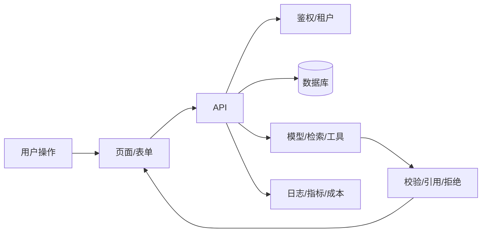

# 纵向切片拆解模板

> 目标：用一个用户可见的闭环证明可行性，而不是先完成所有后端/所有页面。

## 切片声明

```text
用户：<角色>
任务：<在什么场景完成什么>
结果：<可观察的成功>
不包含：<明确排除>
验收：<3–5 条可测试条件>
```

## 数据流



## 最小实现顺序

1. **数据**：一条真实记录 + 迁移。
2. **API**：一个请求/响应/错误格式。
3. **鉴权**：谁能访问哪条数据。
4. **UI**：空/加载/错误/成功。
5. **AI（如需要）**：mock → 真实模型 → 检索/工具 → 引用/校验。
6. **可观测**：trace id、耗时、成本、失败原因。
7. **测试**：API 合同 + 一条端到端 + 关键失败。
8. **演示**：录屏或可点击链接。

## 验收清单

- [ ] 目标用户能独立完成一次任务。
- [ ] 无权限/空数据/模型失败有明确反馈。
- [ ] 数据写对、重复请求不重复写入。
- [ ] 有日志能回答“这次为什么这样输出”。
- [ ] 成本/延迟在预算内。
- [ ] README 写明运行方式、限制、下一步。

## 切片后不要立刻扩功能

先记录：

- 用户卡在哪一步？
- 哪个失败最贵/最频繁？
- 哪些假设被证伪？
- 下一片是“加深主路径”还是“补失败处理”？

再决定是否进入 M2 生产加固。
